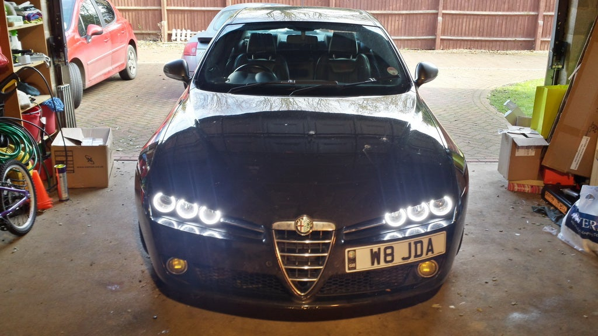

# Project Halo UK

**Angel-eye DRL halo rings for the Alfa Romeo 159, Brera and Spider — with a
custom UK-spec controller that drives them properly.**

Project Halo was a community build that put BMW "angel eye" style LED halo rings
inside the triple-projector headlights of the Alfa Romeo 159, Brera and Spider,
and then built the electronics to make them behave like a factory-fit UK-spec
daytime running light: dimming at night, going to full beam with the main beam,
and dropping out of the way when the indicator flashes.

This repository is the archive of that project — the controller firmware, the
hardware history, and the complete set of build guides, recovered from the
original project wiki, jabawoki.com and the Alfaowner.com build thread.

---

## Contents

| | |
|---|---|
| **[Controller](docs/controller.md)** | Modes of operation, how modes are sensed, hardware revisions Pre-Alpha → v2.2 |
| **[Hardware](docs/hardware.md)** | Schematic, PCB layout, Gerbers and DesignSpark source |
| **[Bill of materials](docs/bom.md)** | Every component with RS/Farnell part numbers |
| **[Firmware](HaloProductionV2.ino)** | The production Arduino/ATmega sketch, with [notes](docs/firmware.md) |
| **[Firmware history](docs/firmware-history.md)** | The eight development sketches, and the fork |
| **[Vehicle applications](docs/vehicle-applications.md)** | Which cars this fits, and ring sizes |
| **[Parts list](docs/parts-list.md)** | Every component, with 2014 prices |
| **[Tools required](docs/tools.md)** | Tools and consumables |
| **[Bumper removal](docs/guides/bumper-removal.md)** | Alfa eLearn dealer procedure, annotated |
| **[Headlight splitting](docs/guides/headlight-splitting.md)** | Getting a sealed headlight open without destroying it |
| **[Installing the rings](docs/guides/ring-installation.md)** | Fitting the rings into the lens assemblies |
| **[Headlight wiring](docs/guides/headlight-wiring.md)** | Tapping the bulb feeds, controller pinouts v2.1 and v2.2 |
| **[Power supplies](docs/guides/power-supply.md)** | Regulated feed from the battery, relay options, voltage tuning |
| **[DIY 12V 10s delay-off relay](docs/guides/diy-delay-off-relay.md)** | Build the timed relay yourself instead of buying one |
| **[Controller troubleshooting](docs/guides/troubleshooting.md)** | Fixing a dead ring on a v2.x board |
| **[Gallery](docs/gallery.md)** | Build and fitted photos |
| **[Videos](docs/videos.md)** | Nine Project Halo videos on YouTube |

---

## How it works

Each headlight gets three LED rings (85 / 90 / 95 mm) and one controller. The
controller has no switches and no configuration — it watches the +12 V feeds to
the bulbs already in the headlight and picks its mode from them:

| Mode | Trigger | Behaviour |
|---|---|---|
| Start-up | Power on | Each ring fades 0 % → 100 % → day level in sequence, inner to outer |
| Day | No lights on | All three rings at day level |
| Night | Driving lights on | All three rings dimmed |
| Main beam | Main beam on | All three rings at 100 % |
| Indicator | Indicator on | Outer and inner rings dropped, middle ring off |

Indicator mode overrides everything else, for safety. Because indicators flash,
the sense logic is debounced with a lockout timer so the rings don't flicker
between modes while the indicator is running.

The sidelight feed is deliberately *not* used, so you can run sidelights at dusk
without the halos dimming.

Bulb feeds reach the microcontroller through opto-isolators, so the sensitive
inputs are never exposed to automotive transients.

---

## Status

**Archived.** This project ran from 2013 to around 2016. Controllers were
designed, manufactured and sold to the Alfa community in three production
revisions (v2, v2.1 green, v2.2 black). The project was later handed over to
Chris and Samir to continue.

Nothing here is for sale. The documentation and firmware are published so the
owners of the several hundred controllers out in the wild can keep them running,
and so anyone who wants to build their own has the full picture.

---

## History

Project Halo started as a concept to integrate BMW angel-eye style DRLs into the
159/Brera/Spider triple headlight configuration. Initial development work was
done by Jay Abbott (JabawokJayUK) and YonasH. YonasH pioneered the first sets of
halos in kit form that could be bought and installed as a DIY solution, but both
of our attempts to disassemble the headlights ended in failure or breakage — the
only viable route was to cut the lenses off, install the rings and glue the
lenses back on.

As that wasn't acceptable, development stopped for around a year, then restarted
after discussions with Coxy1 about headlight disassembly. Coxy1 worked out an
approach to taking the headlights apart, but only on *new* headlights where the
glue hadn't had time to fully cure — several years of use on a car cures it
completely.

With that solved, development restarted on the electronic controllers: built to
meet UK DRL specifications, and designed to need far less wiring and electronics
than YonasH's original approach. Hardware went through a breadboard Arduino
prototype, a through-hole v1, and then a fully surface-mount automotive-grade v2
designed with "Xeropage", which became the v2.1 and v2.2 production boards.

The full project history, several hundred pages of it, is on the
[Alfaowner.com build thread](https://www.alfaowner.com/threads/project-halo-the-159-brera-spider-halo-drl-project.314184/),
and there are nine [build videos](docs/videos.md) on YouTube.

---

## Credits

- **JabawokJayUK (Jay Abbott)** — controller design, firmware, documentation, production
- **YonasH** — original halo concept and first DIY kits
- **Coxy1** — headlight disassembly method
- **Xeropage** — v2 surface-mount hardware design
- **Razor AMD** — DIY 12 V delay-off relay design
- **rjc_147** — D2 diode correction on the relay circuit
- **Chris & Samir** — took the project forward
- **Matt Brown** — post-handover firmware changes in the [fork](https://github.com/nindidooo/ProjectHaloUK)
- The Alfaowner.com 159/Brera/Spider community

---

## ⚠️ Safety and legal

This involves heating headlights in an oven, cutting into your car's lighting
loom and wiring to the battery. You can ruin a set of headlights, and you can
start a fire. Fuse everything, work on new headlights rather than the ones
currently on your car, and know your local lighting regulations — DRL legality
and permitted brightness vary by country.

Everything here is provided as-is, with no warranty of any kind.

## Licence

[MIT](LICENSE) — firmware and documentation. Original photographs remain the
copyright of their respective contributors.
