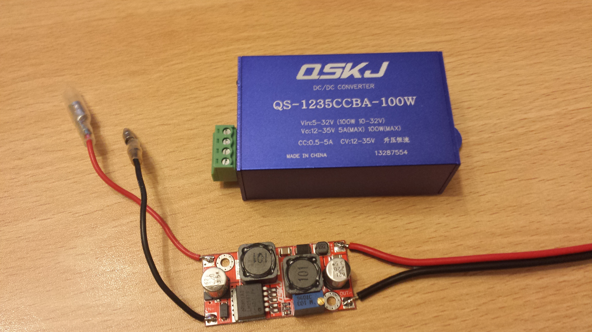

# Bill of Materials

Generated from the DesignSpark PCB design, with the supplier part numbers and
2013 prices as originally costed.

> Prices are from **2013** and in GBP. The costing was done for a batch of 10
> sets (20 controllers, since each car needs two). RS and Farnell part numbers
> are given where they were recorded.

## Cost summary

As costed for a batch of 10 sets of headlights:

| | Estimated | Actual |
|---|---|---|
| 10 sets | £1,405.32 | £761.03 |
| Per set (one car) | £140.53 | £76.10 |
| Per headlight | £70.27 | £38.05 |

The actual came in well under estimate, largely because the crimp tool was a
one-off purchase amortised across the batch rather than a per-unit cost.

## Semiconductors

| Ref | Qty | Part | Description | Supplier | Part no. |
|---|---|---|---|---|---|
| U6 | 1 | ATMEGA328P-PU | Microcontroller AVR 32K flash, 2K SRAM, 28-pin DIP | RS | 696-2260 |
| U2 | 1 | L7805ABP | Voltage regulator 5 V 1 A, TO-220FP | RS | 686-9726 |
| U1, U8, U9 | 3 | 2N7000 | MOSFET N-channel 60 V 0.2 A, TO-92 | RS | 671-4733 |
| D3, D4, D5 | 3 | NUD4001DR2G | High-current LED driver (SMD) | RS | 646-6529 |
| U3, U4, U5 | 3 | FOD852 | Optocoupler transistor, DIP-4 | Farnell | 1495371 |

The schematic labels the optocouplers `FOD817` but the ordered part was the
`FOD852` — worth knowing if you're sourcing from the schematic rather than this
list.

## Passives

| Ref | Qty | Value | Description | Supplier | Part no. |
|---|---|---|---|---|---|
| C1, C12, C13 | 3 | 1 nF | Y2 suppression cap, 250 Vac | RS | 214-5931 |
| C6, C9 | 2 | 22 pF | X1/Y1 disc ceramic, U2J, 500 Vac | RS | 736-8833 |
| C15 | 1 | 10 µF | Radial aluminium electrolytic, 16 V | RS | 228-6622 |
| C7 | 1 | 100 µF | Aluminium electrolytic, 25 V | RS | 365-4127 |
| R1–R6, R8 | 7 | 10 K | Carbon film 0.33 W | RS | 131-378 |
| R7, R11, R18 | 3 | 820 R | Carbon film 0.33 W | RS | 131-249 |
| R12 | 1 | 2R2 | Carbon film 0.33 W | RS | 135-572 |
| R15, R16 | 2 | 2 R | Metal film 0.6 W | RS | 150-638 |
| R9, R10, R13 | 3 | 110 K | Metal film 0.6 W | RS | 148-988 |
| XTAL1 | 1 | 16 MHz | Crystal, HC49S | RS | 693-6970 |

## Connectors

| Ref | Qty | Part | Description | Supplier | Part no. |
|---|---|---|---|---|---|
| J1–J7 | 7 | 640456-2 | 2-way MTA straight friction lock header | RS | 132-0355 |
| J1–J7 plugs | 7 | 770602-2 | 2-way socket housing, 2.54 mm pitch | RS | 293-0026 |
| — | 50 | 770666-1 | Tin-plated crimp contact | RS | 293-0098 |
| — | 1 | 58517-1 | Crimping tool for CST 100 contacts | RS | 293-0111 |

The crimp tool was **£273** — by far the single biggest line item, and the main
reason the per-unit cost only makes sense across a batch. A cheaper generic
crimper will work if you're building one set.

## Board, case and supply

| Item | Description | Supplier | 2013 price |
|---|---|---|---|
| PCB | Etched, ready to solder | PCBTrain | £6 each (qty 24) |
| Enclosure | ABS case 120 × 70 × 30 mm, type G091 | eBay | £3.85 |
| PSU | DC buck/boost converter, LM2587, 3–35 V in, 1.25–30 V out, 2 A | eBay | £5.26 |

## LED rings

Sourced from Alibaba, cool white, 9–30 V, sold in pairs:

| Diameter | LEDs | 2013 price (pair) |
|---|---|---|
| 95 mm | 66 × SMD 3528 | £14.50 |
| 90 mm | 63 × SMD 3528 | £14.50 |
| 85 mm | 63 × SMD 3528 | £14.50 |

Three sizes per headlight. See [Parts List](parts-list.md) for which ring goes
in which lens, and [Installation of the Rings](guides/ring-installation.md) for
fitting.

## Source

The original spreadsheet is
[`Halo Schematic (Bill Of Materials) Spreadsheet.xlsx`](../hardware/bom.xlsx),
generated by DesignSpark PCB.
