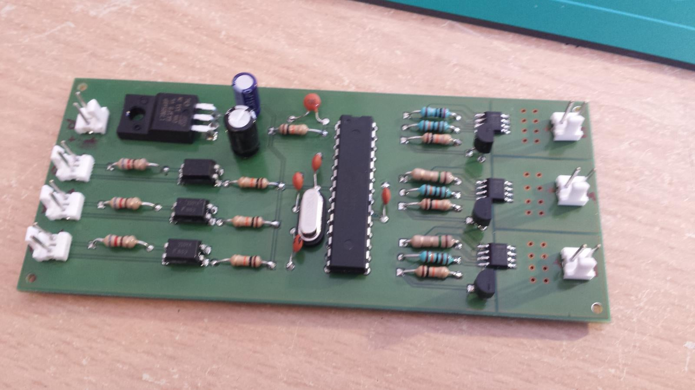
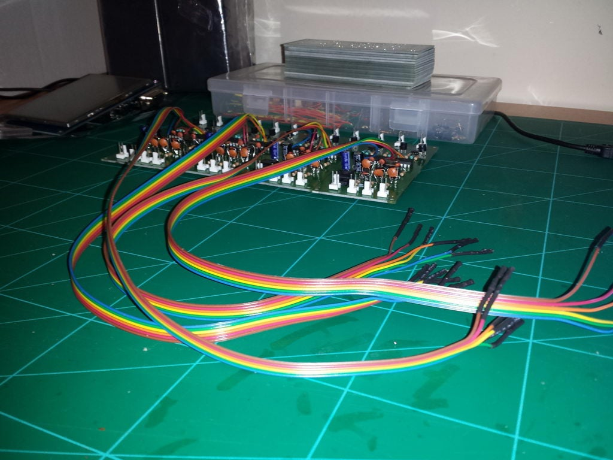
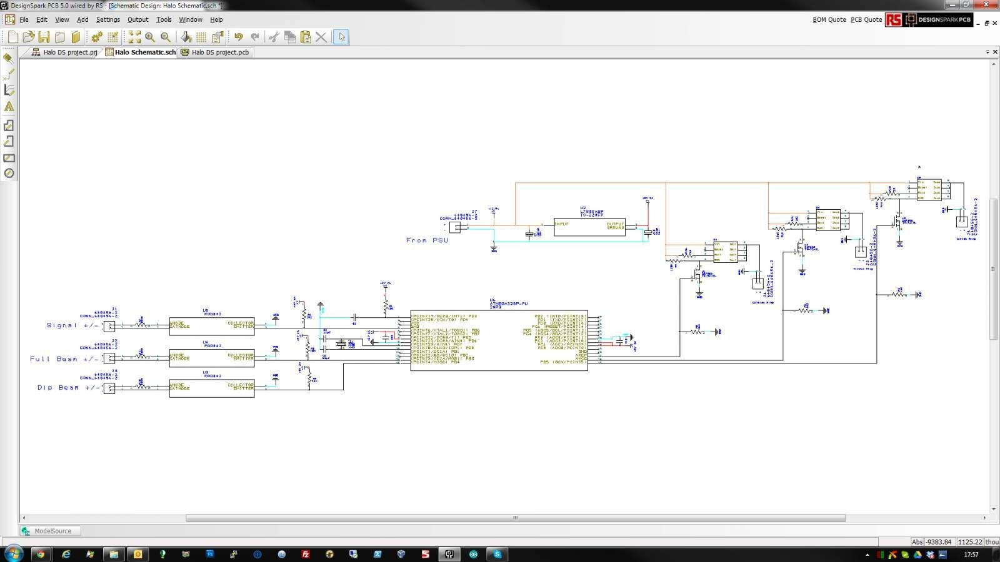
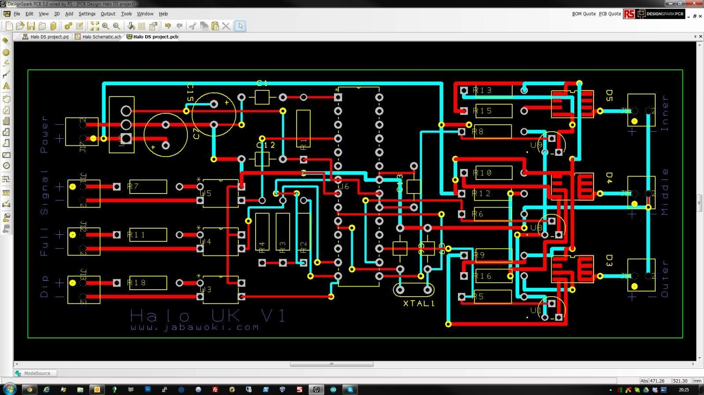
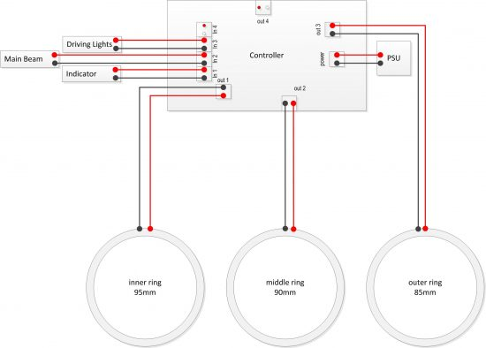
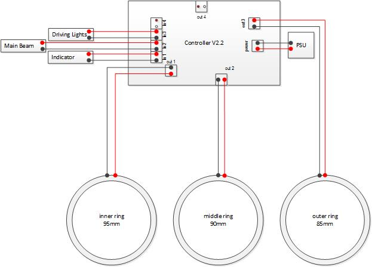
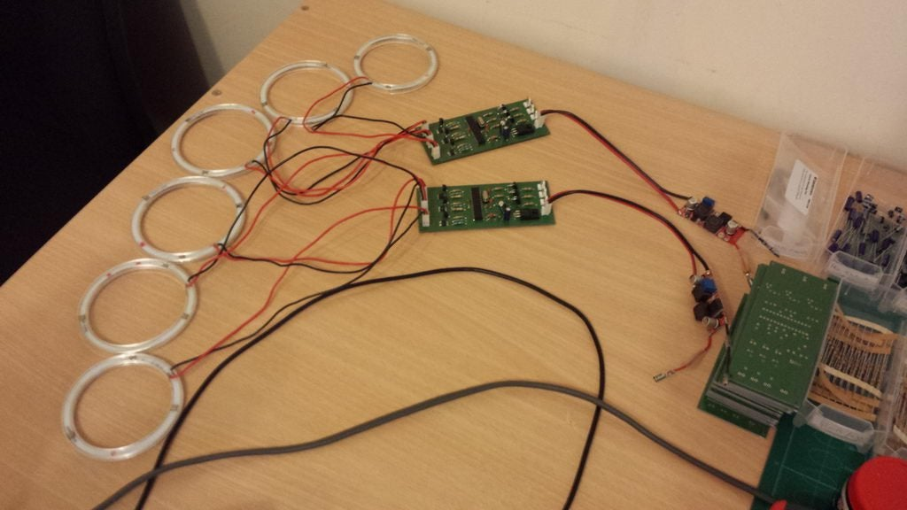

# The DRL Controller

Each headlight has one controller. It takes a regulated DC feed, senses the
car's existing bulb circuits, and drives three LED halo rings with PWM.

## Modes of operation

The controllers were designed to match the behaviour of a UK-specification OE
daytime running light. They work out their mode from what the headlight is doing
at any moment — there is nothing to configure.

**Start-up routine.** The first code that runs on power-up. Each ring is lit in
sequence from 0 % to 100 % and back to about 80 %, inner ring to outer ring,
giving a staged power-on sweep.

**Day mode (default).** No lights switched on. All three rings at about 80 %.

**Night mode.** Driving lights on — whether switched by hand or by the car's
automatic headlight function. The rings dim to about 60 % for night running.

**Main beam mode.** Main/high beam engaged. All rings go to 100 % for maximum
light from the front of the vehicle, for as long as main beam is active.

**Indicator mode.** The most important one. When the indicator is sensed as on,
the controller overrides every other mode: the two outer rings drop to 50 % and
the inner ring switches off, so the indicator is clearly visible. Indicator mode
always wins, whatever the rings were doing.

Because indicators flash, the sense logic has a ~400 ms delay built in. Without
it the mode bounces every time the indicator blinks. With it, indicator mode
holds until the indicator genuinely stops, and the controller then returns to
whichever mode was previously selected. Anything much under 400 ms produces
occasional bounces, so 400 ms is the safe figure.

> The firmware in this repository uses a 250 ms debounce with a 1.5 s lockout
> timer to achieve the same result — see [firmware.md](firmware.md).

## How modes are selected

When +12 V is applied to a given bulb in the headlight, a set of jumper wires
from that bulb feeds one of the controller's inputs, where the voltage is
detected and the mode changed.

The controller uses an **opto-isolator** on each input, so the microcontroller
is protected from the potentially harmful transient voltages on the bulb feeds.

Feeds monitored in each headlight:

- Driving lights
- Main beam
- Indicator

The sidelight feed is deliberately left alone, so sidelights at dusk don't dim
the halos.

See [Headlight wiring](guides/headlight-wiring.md) for how to tap these feeds
and the controller pinouts.

## Hardware revisions

The controller hardware was custom designed by JabawokJayUK with help and
support from RC.

### Pre-Alpha

A breadboard Arduino platform — the test bed where the design and R&D happened.

### Version 1

The first generation used a **through-hole** design, for ease of prototyping and
short-run assembly.

Despite the care taken in the design, mass-market resale was judged impractical:
assembly time was too high, and solder joints would degrade over the long term.
Only three cars ever ran v1 boards, with the intention they would eventually be
replaced by v2 hardware.

### Version 2

The second generation was designed entirely by **Xeropage**, a fellow
electronics enthusiast from the security industry. The original schematic was
taken, adapted and migrated into a fully **surface-mount** design. All components
are **automotive grade** — rated for greater temperature extremes and better
suited to the harsh environment of a car.

Version 2 also expanded the design with an extra +12 V trigger input and an
extra ring output:

- Most vehicles need 2 or 4 rings rather than the 6 the 159/Brera/Spider needs,
  so a single controller could drive 4 rings and take main beam, driving lights
  and two indicator triggers — making the unit viable on other cars.
- On the 159/Brera/Spider, the spare input can sense the ignition +12 V feed.
  Combined with a timed-off relay that keeps the units powered after the
  ignition is switched off, the controller can tell that power is about to
  disappear and run a power-off routine before it does.

### Version 2.1 — green boards

The first version shipped to customers. Only minor differences from v2. Easily
identified by its **green circuit board**.

### Version 2.2 — black boards

Component voltage ratings were improved to better protect against shorts and
over-voltage, and the PCB supplier and finish changed to a better-quality gold
plated board. These are **black**, so immediately identifiable.

> ⚠️ **v2.1 → v2.2 is not a drop-in swap.** The board revision re-routed the
> positive and negative tracks, so the polarity of V-IN (power from the PSU) is
> different and the connector handing is reversed. Check the diagrams before
> plugging a v2.2 into a loom wired for a v2.1.

## Ring wiring

The LED rings ship with a small in-line regulator box attached. **These must be
removed** — the controller regulates the power itself using PWM, and leaving the
regulators in place stops the controller dimming the rings.

> The original forum post illustrated this with a diagram of the ring and its
> in-line regulator. That attachment is no longer retrievable — the forum's
> image host now serves unrelated content for its ID. See
> [SOURCES.md](../SOURCES.md).

## Bench testing

Before fitting anything to the car, bench-test each controller with its rings on
a regulated supply. Check all five modes by applying +12 V to each input in turn.

If a ring doesn't light, see [troubleshooting](guides/troubleshooting.md).
