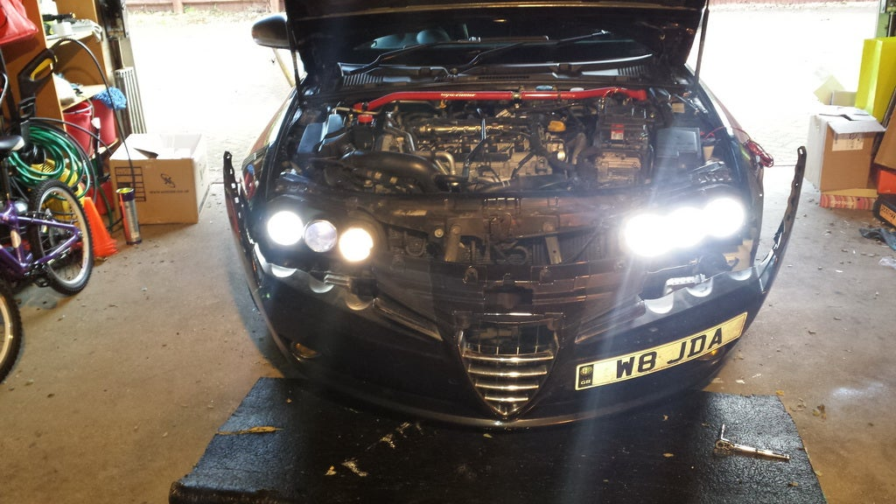
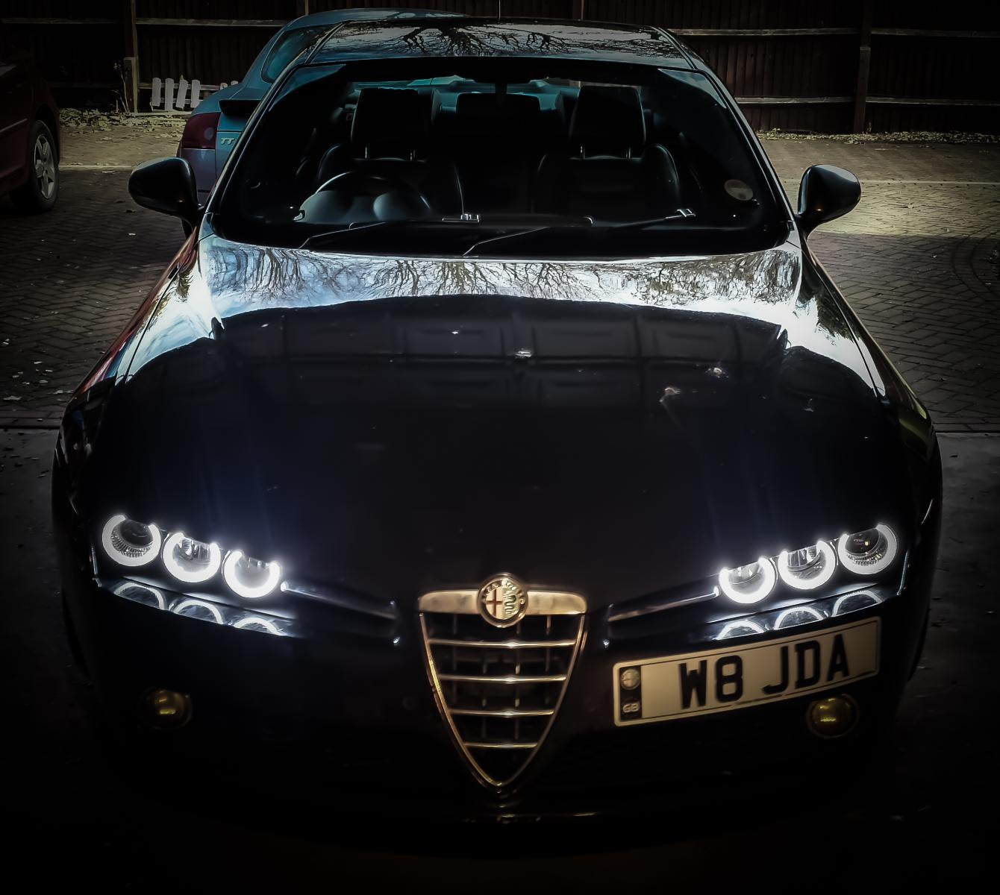
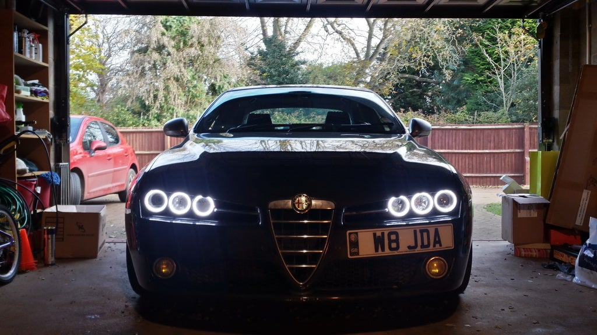
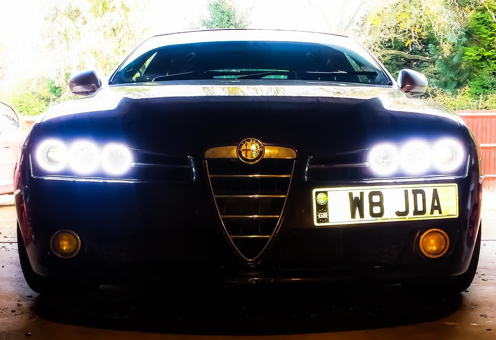
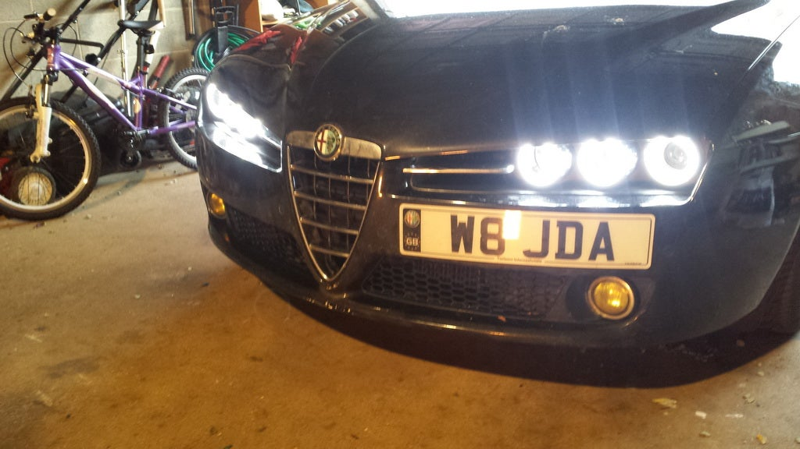
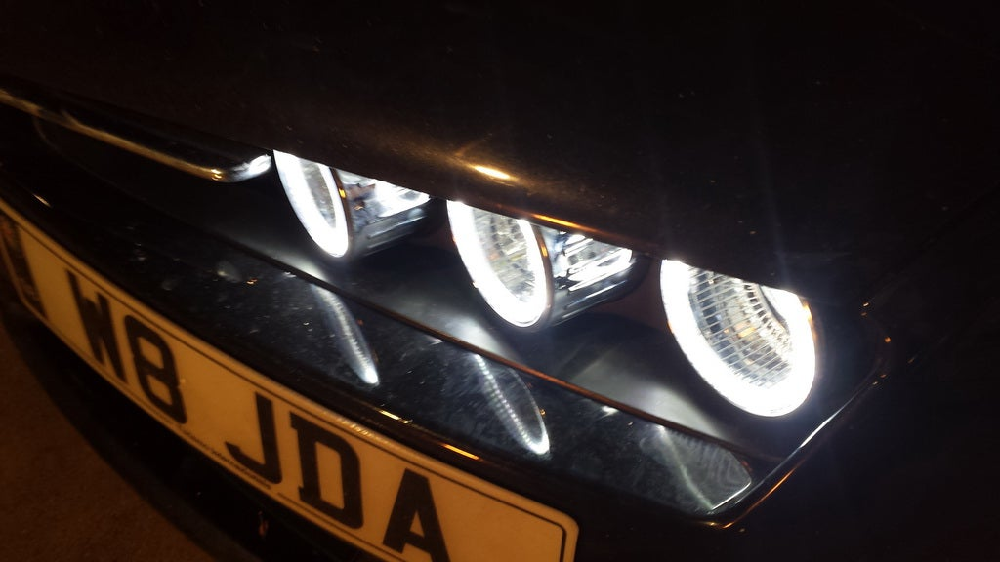
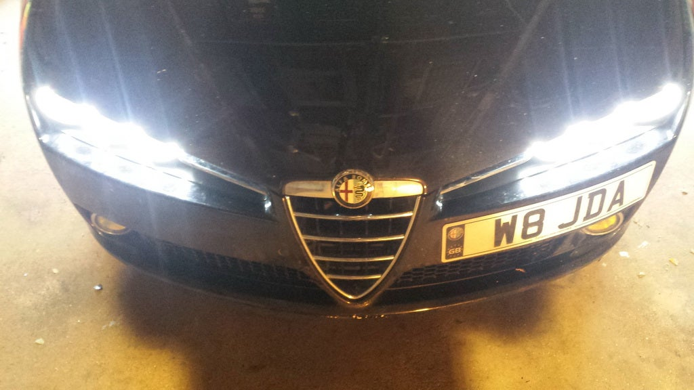
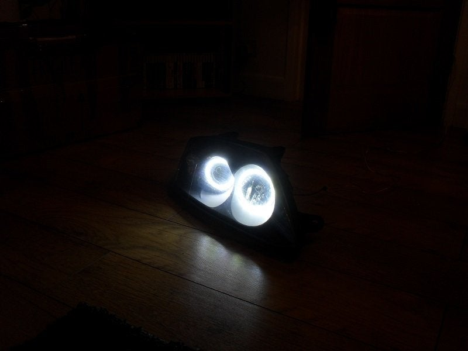
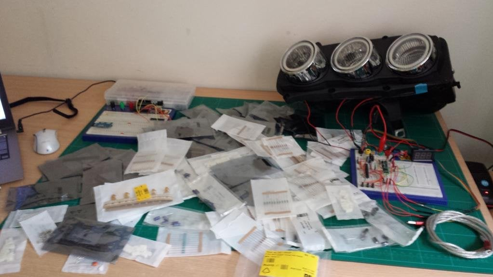
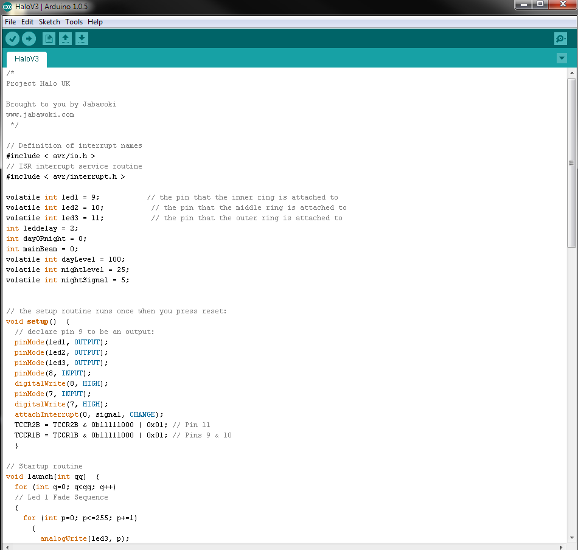

# Gallery

## Fitted

The finished article — halo rings running as daytime running lights on a 159.

## Development

Early ring testing in the dark, before any controller existed.

Component parts laid out.

Bench build — controllers wired up with rings for testing.

## Hardware

v1 schematic, drawn in DesignSpark.

v1 PCB layout.

Controller I/O layout.

Firmware under development.

## Installation

Donor headlights, ready to be worked on.

Bumper off, headlight location exposed.

Power supply and relay installed in the engine bay.

## Ring colour reference

The difference between "white" (~5500 K) and "cold white" (~7000 K) rings.

---

## Video

The original demo video of the headlights in operation on the car:
https://www.youtube.com/watch?v=qOf9f99d9EU

---

*Photographs recovered from jabawoki.com and the
[Alfaowner.com build thread](https://www.alfaowner.com/threads/project-halo-the-159-brera-spider-halo-drl-project.314184/).
Images remain the copyright of their respective contributors.*
