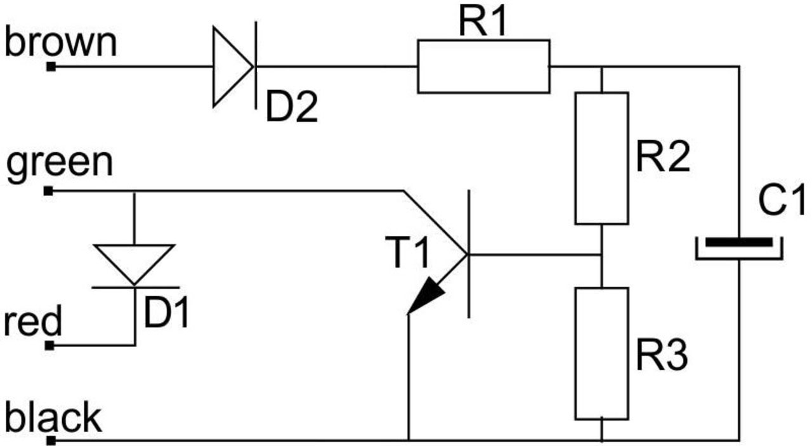
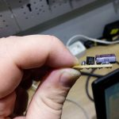
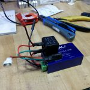
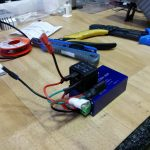
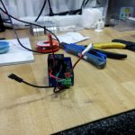
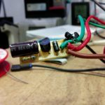

# Make Your Own 12 V 10 s Delay-Off Relay

The off-the-shelf Durite pre-programmed delay-off timer relay is about **£48**.
This circuit does the same job for a few pounds, and it's very easy to build.

Credit to **Razor AMD** for the circuit and content, and to **rjc_147** for
pointing out the D2 diode.

## Schematic

## Parts

| Ref | Part |
|---|---|
| R1 | 6.8 Ω |
| R2, R3 | 100 kΩ |
| D1, D2 | 1N4007 |
| T1 | 2SD892 (Darlington NPN transistor) |
| C1 | 100 µF / 25 V |

**Alternative transistor** — if you can't find a 2SD892:

| Ref | Part |
|---|---|
| T1 | BC517 |
| C1 | 33 µF / 25 V |

The BC517 has a higher hFE than the 2SD892, so the capacitor has to change to
suit.

## Connections

| Wire | Goes to |
|---|---|
| **BROWN** | Ignition (+12 V) |
| **GREEN** | Relay terminal 85 |
| **RED** | Constant power supply (+12 V) |
| **BLACK** | Ground (−12 V) |

## Changing the delay

To change the delay-off time, change **C1**:

- **Longer** delay → higher capacitance
- **Shorter** delay → lower capacitance

Change the **capacitance only, not the voltage rating**.

## The relay

Buy one **4-pin car relay (NO — normally open)**.

- Bring constant power to relay pins **86** and **30**.
- Relay pin **87** gives +12 V to the DC-DC converter when the ignition is on,
  and for 10 s after the ignition is switched off.

## Built up

Here's the circuit built and coupled with the DC-DC converter:

---

*Originally documented on jabawoki.com. Content by Razor AMD.*
