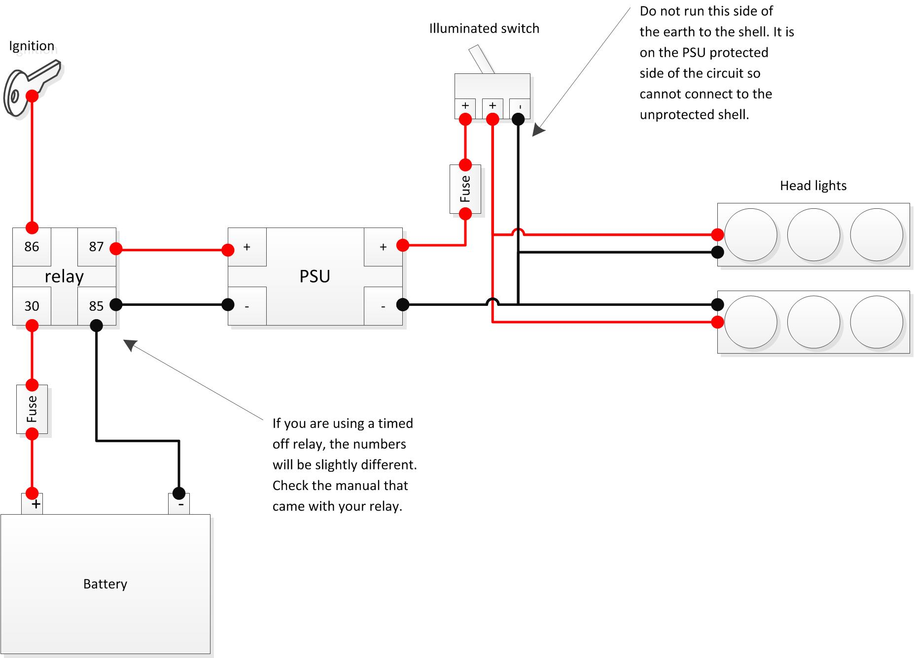
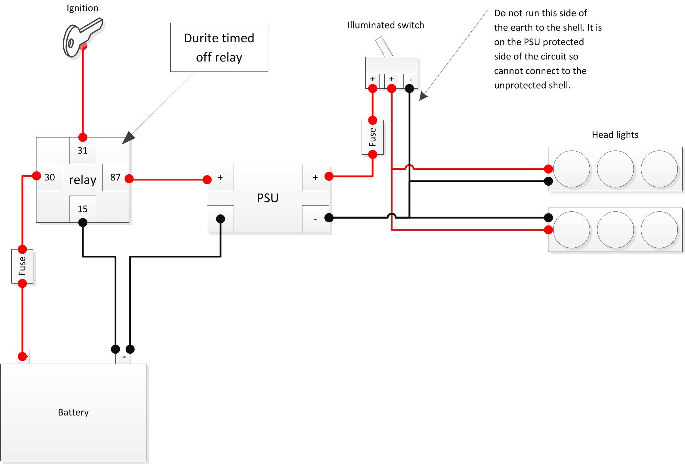
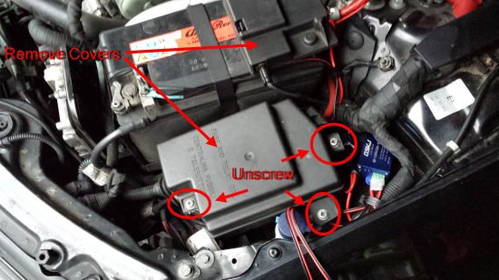
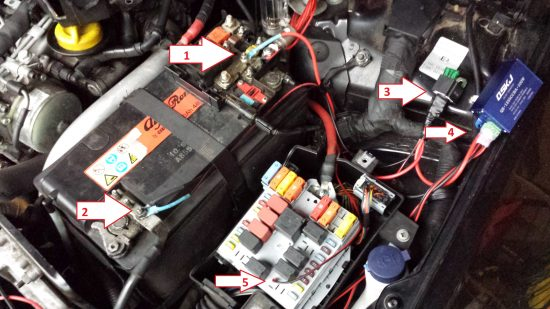
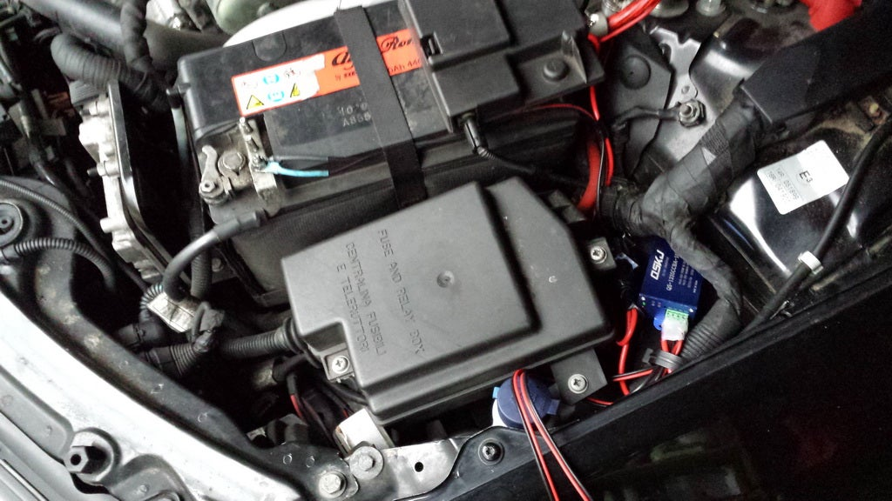
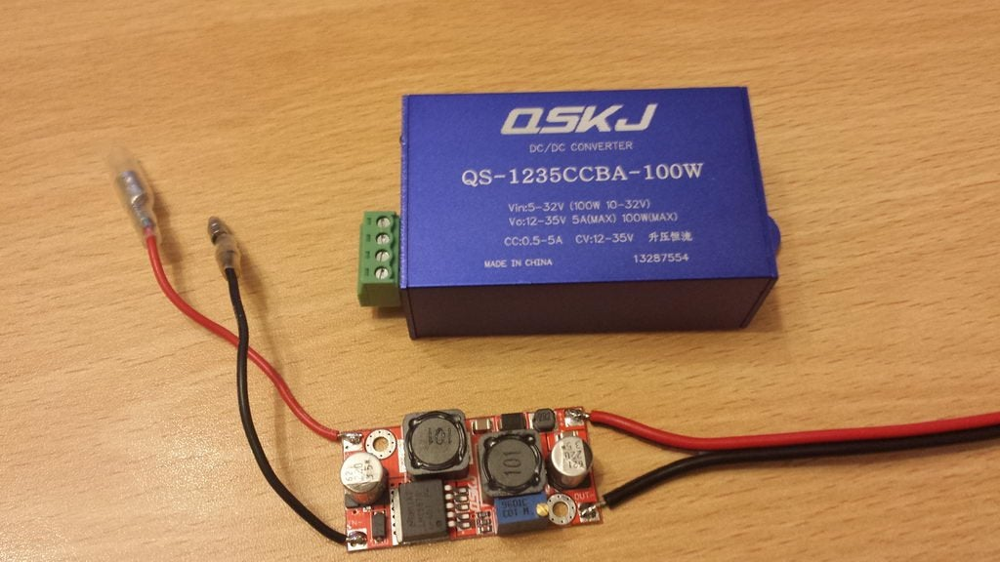
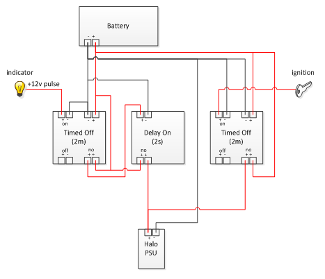

# Power Supplies

## Overview

The halo units need good, clean, regulated power or they will burn out.

A car's power supply is the exact opposite of this: dirty, unregulated, and a
very bad place for electrical items to live. Most electronics in a car have
additional protective mechanisms to keep them safe, and the halo controllers and
rings are no different.

Check the [parts list](../parts-list.md) for the components you need.

> This wiring can be done at any time, ahead of the halos being installed — it
> doesn't affect anything else in the car.

## The idea

Provide a direct feed from the battery to a DC-DC power supply unit, switched
via the ignition feed, and then run two power leads from that PSU out to the
headlight locations, ready for connection to the halo controllers.

## Relay options

You have two choices for the switching relay:

**Standard 12 V relay (~£5).** Simple and cheap. The halos cut out while the
engine cranks.

**12 V 10 s delay-off relay (~£48).** Keeps the units powered for 10 seconds
after the trigger drops, so the rings stay lit through engine cranking. Also
lets the v2 controllers sense that power is about to go and run a power-off
routine.

> You can also [build the delay-off relay yourself](diy-delay-off-relay.md) for
> a few pounds instead of buying the Durite unit.

## Wiring the power supply

Open the bonnet to access the area you'll be working in.

1. Un-clip the cover to the fuse holder on top of the battery.
2. Remove the lid of the fuse box next to the battery — three Philips screws.

Now, using Figure 2 as reference:

- Cut an **18–24″ length of 12 V twin core 8.75 A wire** and crimp circular tabs
  on the end. Cut the red/power wire shorter than the black/negative so the wire
  runs neatly along the battery, leaving room to fit the **in-line blade fuse
  holder** in line on the positive feed, crimped or soldered. *(Fig 2, #1 & #2)*
- On the opposite end, crimp two female spade connectors. Attach the **negative**
  to relay terminal **85**. *(Fig 2, #3)*
- On the same length, attach the **positive** female spade to relay terminal
  **30**. *(Fig 2, #3)*
- Cut another **18–24″ length**, strip away the positive leaving only the
  negative. Crimp a circular tab on one end, strip 0.25″ bare on the other.
  Attach the bare end to the PSU screw terminal marked **"IN −"**. *(Fig 2, #4)*
- Cut **6″** off the spare positive from the previous step. Crimp a female spade
  on one end and attach it to relay terminal **87**. Strip 0.25″ bare on the
  other and attach to the PSU terminal marked **"IN +"**. *(Fig 2, #4)*
- With the remaining positive wire, crimp a **male** spade on one end and a
  **female** on the other. Insert the male spade into the fuse box *(Fig 2, #5)*
  and connect the female end to relay terminal **86**.
- Connect the two negative circular connectors to the **negative side of the
  battery** with an 8 mm spanner or socket *(Fig 2, #2)*, and the positive
  circular connector to the **positive side of the battery, before the fuses**
  *(Fig 2, #1)*.

**Test it:** switch on the ignition and check that the PSU's green LED lights.
If it doesn't, go back and double-check every connection.

### Mounting

The PSU and relay push easily into the space between the fuse box and the
suspension turret, and the loom running over the top holds things in place
reasonably well. Your engine bay may differ — if you need another location,
adjust the cable lengths above accordingly.

## Headlight runs

With the PSU in and running, all that's left is to run 12 V twin core 8.75 A
cable to each headlight.

- Cut a length long enough to reach the **nearest** headlight and fit a **2-pin
  Superseal female** connector to one end.
- Cut a second length long enough to reach the **furthest** headlight and fit a
  2-pin Superseal female connector to one end.

> Leave enough slack at each headlight to allow fitting and removal of the units.

- Strip back about 0.5″ of positive and negative on both wires, at the end with
  no connector.
- Twist both positives together; twist both negatives together.

> Solder these twisted joints. They will work loose otherwise.

- Attach the positives to the PSU terminal **"OUT +"** *(Fig 2, #4)*.
- Attach the negatives to the PSU terminal **"OUT −"** *(Fig 2, #4)*.
- Run the wires neatly around the engine bay, cable-tying them en route to keep
  them clear of the engine's moving parts.

> ⚠️ **Add an in-line 2 A fuse to each headlight run.** Some project members had
> a PSU spike and destroy their controllers. A 2 A fuse per run protects the
> controllers in the event of a power surge from a faulty PSU.

## Tuning the voltage

The PSU has two small screws near the LEDs, attached to internal trim pots. Each
adjusts the voltage and current the supply delivers. The halos and rings are low
power, so they won't tax the PSU.

1. With a multimeter, set the PSU to **10 V output**.
2. Connect it to the controller, and connect the rings.
3. With the rings lit through the controller, put the meter between the **+ve
   input to the controller** and the **+ve output to the ring**, and adjust for
   about **1 V**.

1 V is about right — the NUD datasheet calls for more than 0.7 V and, thermally,
less than 1.5 V.

> You can measure the current a system draws by putting a multimeter in line with
> the feed to the controllers: https://www.youtube.com/watch?v=HWA9WqSEjg8

> ⚠️ **Do not over-volt the controllers.** Excess input voltage has to go
> somewhere, and it goes to heat — which will cause the controllers to fail. Far
> too much input voltage simply blows the input regulator to the
> microcontroller and fries the board. This failure mode is easy to identify
> after the fact.

## The result

A dedicated feed to the halo controllers that is regulated, protected, and
switched by the vehicle's ignition. With the timed-off relay, it stays powered
for the delay period you chose (10 s suggested) after the ignition is switched
off.

---

## Optional: "welcome light" on remote unlock

A relay arrangement discussed on the build thread, which lights the halos for a
couple of minutes when you unlock the car, as well as on ignition.

The diagram chains three relays between the battery and the halo PSU:

- A **timed-off (2 min)** relay triggered by the **+12 V pulse** the car sends
  to the indicators when it is remotely unlocked.
- A **delay-on (2 s)** relay in that path, so a brief pulse doesn't trigger it
  and the halos don't flash every time the indicators do.
- A second **timed-off (2 min)** relay triggered by the **ignition** feed.

Either path powers the PSU, so the halos run on unlock *or* with the ignition
on, and fade out a couple of minutes after.

> This is a community extension, not part of the standard install. It needs
> three timer relays rather than one, and it taps the indicator feed at the car
> rather than inside the headlight. Build the standard power supply above first
> and get it working before adding this.

---

*Originally documented on jabawoki.com.*
