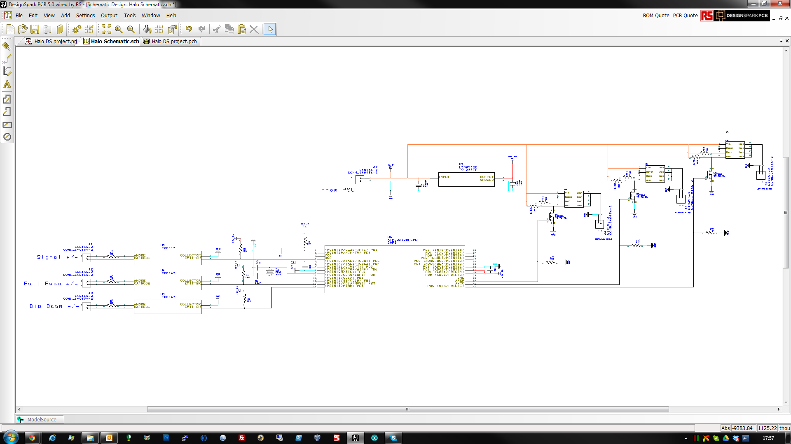
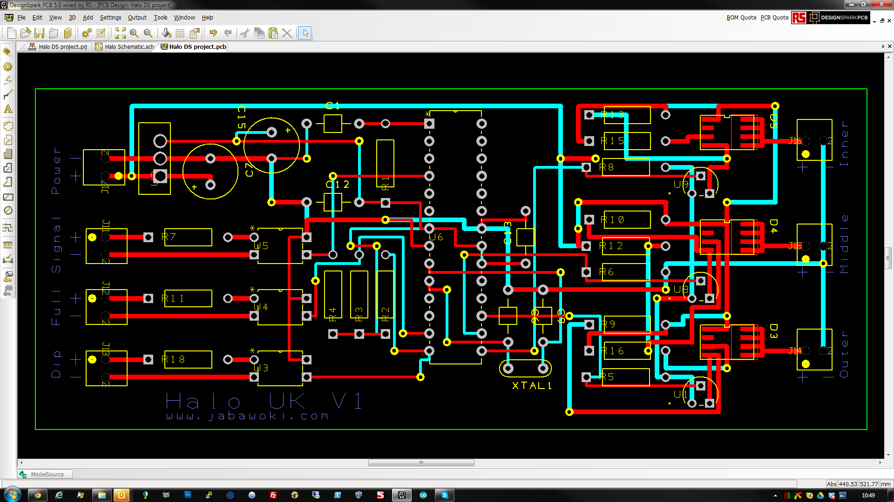
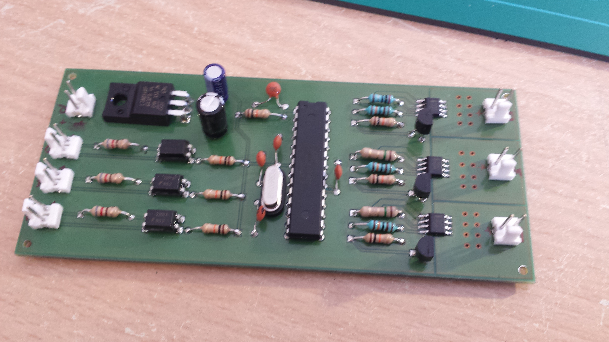
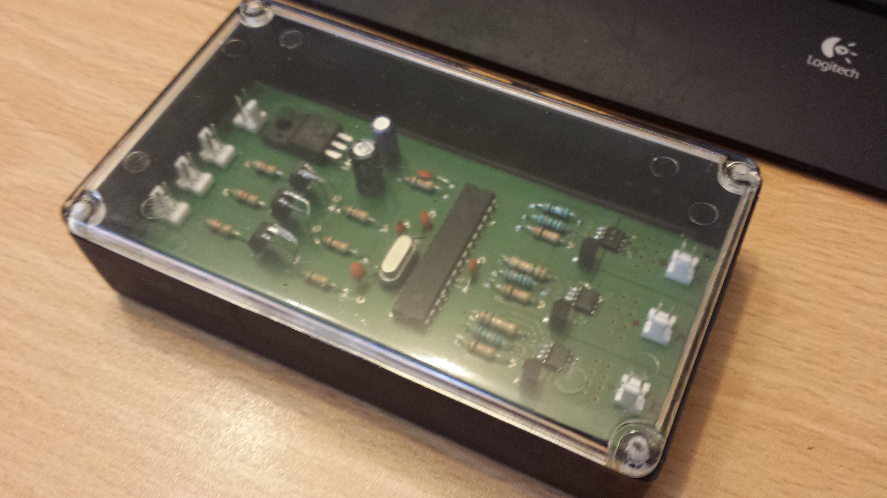

# Hardware

The controller PCB — schematic, board layout, Gerbers and bill of materials.
Everything needed to have boards made.

## What's here

| Path | What it is |
|---|---|
| [`hardware/schematic.pdf`](../hardware/schematic.pdf) | Full circuit schematic |
| [`hardware/pcb-layout.pdf`](../hardware/pcb-layout.pdf) | Board layout |
| [`hardware/3d-render.pdf`](../hardware/3d-render.pdf) | 3D render of the populated board |
| [`hardware/designspark/`](../hardware/designspark/) | DesignSpark PCB source — `.sch`, `.pcb`, `.prj` |
| [`hardware/gerbers/`](../hardware/gerbers/) | Gerbers + Excellon drill files, ready for a fab |
| [`bom.md`](bom.md) | Bill of materials with part numbers |

The DesignSpark files are the editable source. DesignSpark PCB is still a free
download from RS, so these can be opened and modified.

## Which revision these are

The recovered tree held several copies of the design at different dates. The
files here are from `Halo Production V2`, dated **15 October 2013** — the newest
and the one matching the production boards. Earlier copies (July and August
2013) were left out to avoid shipping two conflicting versions of the same
board.

## Circuit summary

Built around an **ATmega328P** at 16 MHz, running at 5 V from an **L7805AB**
regulator fed by the external buck converter.

**Inputs** — three `FOD852` optocouplers isolate the controller from the car's
12 V side. They sense the indicator, main beam, and driving lights. A fourth
input is brought out for expansion but unused.

**Outputs** — three `NUD4001` constant-current LED drivers, one per ring,
PWM-driven from the ATmega. A fourth output is wired for expansion.

`2N7000` MOSFETs handle level shifting. The board is through-hole apart from the
`NUD4001`s, which are surface mount — deliberately, so it can be hand-assembled.

The jumpers on pins 0 and 1 double as serial lines if you need them.

## Enclosure

A 120 × 70 × 30 mm ABS case, one per headlight.

## Having boards made

The Gerbers in [`hardware/gerbers/`](../hardware/gerbers/) are a complete plot
set: top and bottom copper, resist, paste, silkscreen, documentation layers, and
both plated and unplated drill files. The originals went to
[PCBTrain](https://www.pcbtrain.co.uk/).

Build and troubleshooting notes are in [Controller](controller.md) and
[Troubleshooting](guides/troubleshooting.md) — in particular, check for broken
vias before assuming a component fault.
