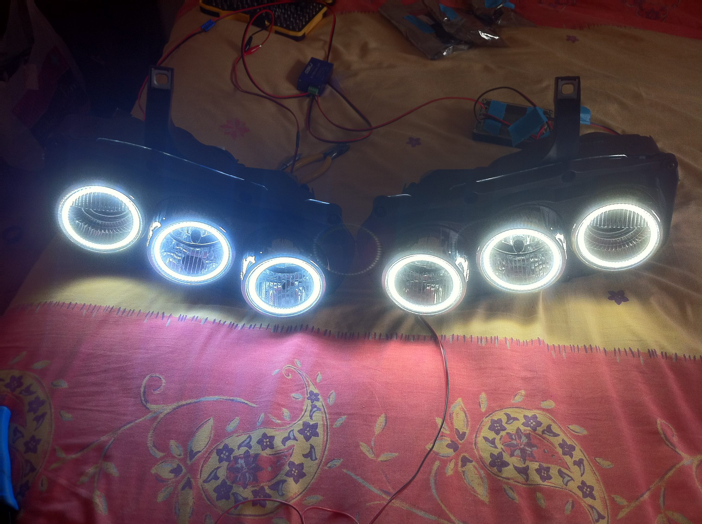

# Parts List

Everything needed to build one car's worth of halos — two headlights, two
controllers, six rings.

> **Prices are from 2014** and are listed in GBP as originally documented. All
> supplier links are historical; most are long dead. They're kept for part
> numbers and identification.

## Power supply parts

| Item | Unit | Qty | Total | Supplier | Purpose |
|---|---|---|---|---|---|
| 12 V 10 s delay-off relay (Durite 0-740-47) | £48.00 | 1 | £48.00 | thetoolboxshop.com | Continuous operation while the engine starts |
| DC-DC converter PSU (QS-1212CCBA 80 W, CC/CV) | £16.90 | 1 | £16.90 | eBay | Clean regulated power to the system |
| Superseal connector, 2-pin female (1.5 mm) | £2.50 | 2 | £5.00 | thetoolboxshop.com | Headlight to PSU |
| Superseal connector, 2-pin male (1.5 mm) | £2.68 | 2 | £5.36 | thetoolboxshop.com | Headlight to PSU |
| 12 V twin core 6 A wire (per metre) | £0.65 | 6 | £3.90 | thetoolboxshop.com | Connections inside the headlights |
| 12 V twin core 8.75 A wire (per metre) | £1.16 | 6 | £6.96 | thetoolboxshop.com | PSU to headlights |
| Mini blade fuse holder, in-line splash-proof | £3.40 | 1 | £3.40 | thetoolboxshop.com | Safety |
| Mini blade fuse, 5 A | £1.00 | 1 | £1.00 | Halfords | Get it anywhere |

**The delay-off relay is optional.** If you don't need the rings to stay lit
during engine crank, a plain **12 V 30 A make-and-break relay** (Durite 0-727-12)
does the job for around **£5** — a £43 saving. See
[power supplies](guides/power-supply.md) for the difference.

You can also [build the delay-off relay yourself](guides/diy-delay-off-relay.md)
for a few pounds in components.

> See [power supplies](guides/power-supply.md) for the recommended **additional
> 2 A in-line fuse on each headlight run** — not in the original list, but added
> after several controllers were destroyed by PSU spikes.

## Halo parts

| Item | Unit | Qty | Total | Supplier | Notes |
|---|---|---|---|---|---|
| CST100 tin-plated crimp contact | £0.10 | 50 | £5.00 | RS (293-0098) | Packs of 50 only — makes 25 connectors |
| 2-way socket housing, 2.54 mm pitch | £0.09 | 20 | £1.88 | RS (293-0026) | Packs of 10 |
| Heat shrink, 3.2 mm 2:1 | £3.13 | 1 | £3.13 | RS | Connections inside the headlight |
| DRL controller module | £50.00 | 2 | £100.00 | jabawoki.com | Creates the magic |
| 90 mm rings (63 SMD 3528) | £11.00 | 1 | £11.00 | AliExpress | Middle lens |
| 95 mm rings (66 SMD 3528) | £11.00 | 1 | £11.00 | AliExpress | Inner lens |
| 85 mm rings (63 SMD 3528) | £11.00 | 1 | £11.00 | AliExpress | Outer lens |

> **Controllers are no longer available.** The project is archived and nothing
> here is for sale. The firmware is in this repository; the v1 schematic and PCB
> layout are in [controller.md](controller.md).

### Ring colour

Specify the colour carefully when ordering:

- **"White"** — about **5500 K**, a perfect match for HIDs
- **"Cold white"** — an electric blue hint, closer to **7000 K**

## Optional (but strongly recommended) parts

| Item | Unit | Qty | Total | Supplier |
|---|---|---|---|---|
| Set of headlights (Alfa 159, pair, O/S + N/S) | £166.00 | 1 | £166.00 | eBay |

Technically optional, but **buy two new headlights to work on.** The OE
headlights use a glue that is near impossible to melt once cured by years of
use. New units also let you work at your own pace without leaving your car in a
state unfit to drive — and you can sell your OE headlights on to recover some of
the cost.

> **Order the right ones.** LHD and RHD units differ. Different makes exist —
> Lucas and Depo are the most common.
>
> *"I have Depo lights on mine and I don't like them. They are clearly a lesser
> quality and I have had issues with the adjustable motors to raise and lower
> the light beam stripping the cogs. Others have Depo lights with no issues so
> it could just be the amount of abuse I have given them during development."*

## See also

- [Tools required](tools.md)
- [Vehicle applications](vehicle-applications.md) — ring sizes for other cars

---

*Originally documented on the Project Halo wiki.*
